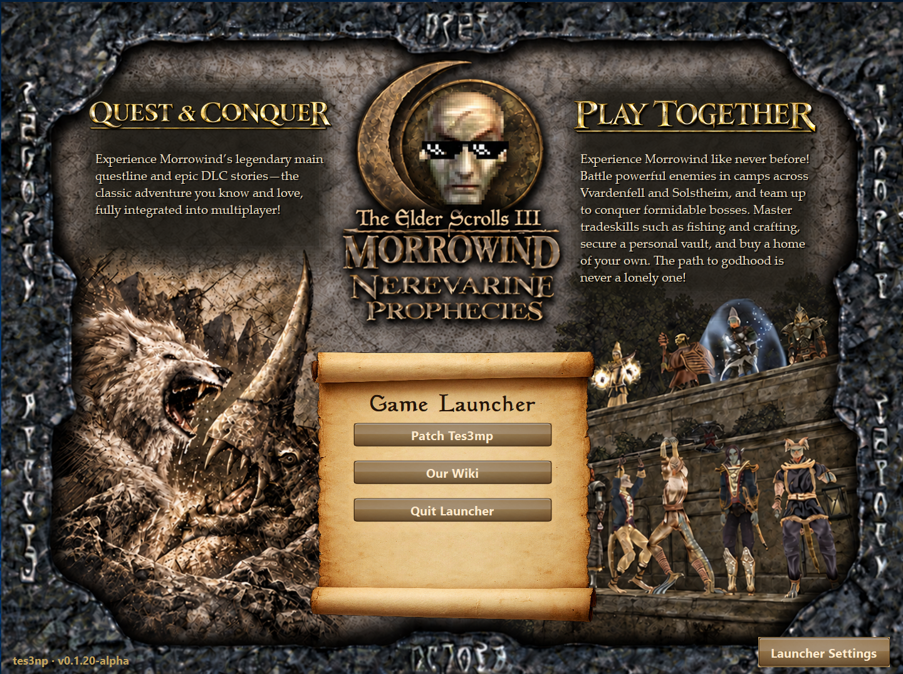

# tes3np

> **Looking for the current release?** Use the [official TES3NP website](https://iamshawn98.github.io/tes3np/) or [GitHub Releases](https://github.com/IAmShawn98/tes3np/releases). This repository serves the one-time updater bridge for v0.1.20-alpha. The features and installation steps below describe the archived .20 build.

**tes3np** is a work-in-progress launcher and built-in patcher for the Morrowind server [Nerevarine Prophecies](https://wiki.nerevarineprophecies.com/).

## Features

- **Character Management & Automation** — Save up to 10 characters, choose a default, automatically log in, launch multiple characters in sequence, schedule daily logins, and optionally recover from crashes or unexpected closes.
- **Built-in Patcher** — Apply supported Nerevarine Prophecies patches directly through the launcher without manually replacing files.
- **Macro Manager** — Import, manage, run, and stop AutoHotkey macros, including supported ZIP macro packages.
- **Portable Character Backups** — Export your characters and launcher settings for backup or transfer to another computer.
- **Automatic Updates** — Download, verify, and install new tes3np versions directly through the launcher.

## Download

For the current Windows ZIP, click **Download for Windows** on the [official TES3NP website](https://iamshawn98.github.io/tes3np/) or choose the newest versioned ZIP from [GitHub Releases](https://github.com/IAmShawn98/tes3np/releases).

For an upgrade test or an archived installation, use [`tes3np-v0.1.20-alpha-windows.zip`](https://github.com/IAmShawn98/tes3np/releases/tag/v0.1.20-alpha). The legacy updater reads `tes3np-update.json` and downloads `tes3np-windows.zip` to install v0.1.21-alpha.

## Requirements

- [Morrowind Game of the Year Edition](https://en.uesp.net/wiki/Morrowind:Morrowind)
- [TES3MP 0.8.1 Win64](https://github.com/TES3MP/TES3MP/releases/tag/tes3mp-0.8.1)
- Windows

## Install

1. Download `tes3np-v0.1.20-alpha-windows.zip` from the [archived .20 release](https://github.com/IAmShawn98/tes3np/releases/tag/v0.1.20-alpha).
2. Extract the ZIP.
3. Move the extracted `tes3np` folder into your TES3MP 0.8.1 Win64 folder.
4. Do not move or remove individual files from the `tes3np` folder.
5. Run `tes3np.exe`.

## Update

When a newer version is available, tes3np can download, verify, and install the update from the launcher.

For a manual update, get the current Windows ZIP from the [official TES3NP website](https://iamshawn98.github.io/tes3np/) and follow the [player guide](https://github.com/IAmShawn98/tes3np/blob/main/docs/USER-GUIDE.md).

## Troubleshooting

If the launcher reports an error, copy the relevant log from **AppData Settings** or take a screenshot of the error message and include it when reporting the problem.
